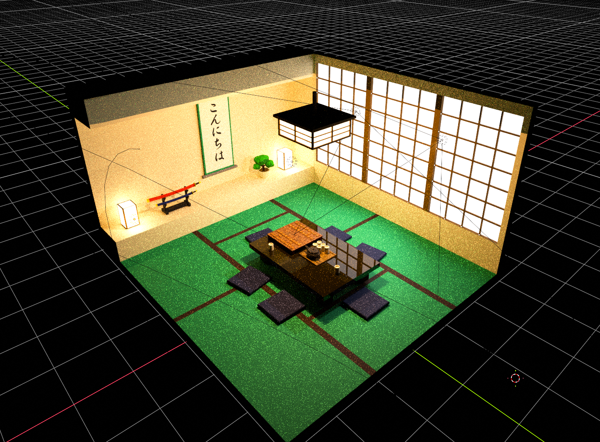
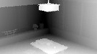
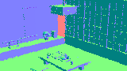
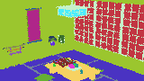
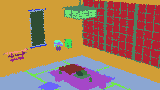
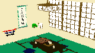
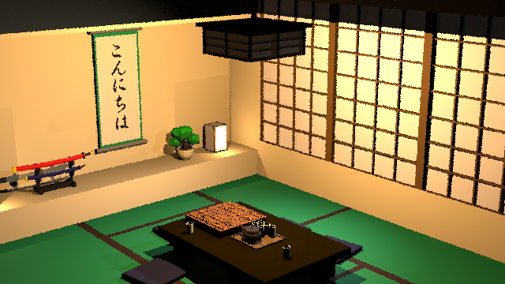

# Distributed Ray Trace Benchmark

**以 CPU 路径追踪比较串行、本地多进程和局域网分布式执行。**

**A CPU path-tracing benchmark comparing serial, local multiprocessing, and LAN execution.**

[项目简介 / Overview](#overview) · [数学模型 / Mathematics](#mathematics) · [渲染 Pass / Rendering pass](#rendering-pass) · [本地并行 / Local parallelism](#local-parallelism) · [分布式 / Distributed execution](#distributed-execution) · [使用指南 / User guide](#user-guide) · [许可证 / License](#license)

<a id="overview"></a>
## 0. 项目简介 / Overview



*Blender Cycles 预览，作为场景参考。 / Blender Cycles preview, shown as a scene reference.*

项目实现基于蒙特卡洛采样的 CPU 物理路径追踪：相机射线经两级 BVH 求交，再计算纹理、GGX 反射、光源可见性与路径贡献。像素样本在只读场景上独立计算，只需在末端汇总 RGB，因此能自然拆分为小任务。不同像素的几何、遮挡和反射路径又会产生不均匀耗时，适合观察负载均衡与尾部等待。计算中同时包含浮点运算、分支、非连续访存，以及场景准备、进程和网络通信，能够代表 HPC 中一类细粒度、任务并行的蒙特卡洛负载。三种模式共享数值内核、任务定义和集中验收逻辑，便于比较同一工作负载的计算、调度及通信成本；当前低采样配置用于功能验证与吞吐比较。

The project implements Monte Carlo CPU path tracing with two-level BVH traversal, texture evaluation, GGX reflection, light visibility, and path accumulation. Pixel samples independently read the scene and return RGB contributions, making them natural task units. Geometry, occlusion, and reflection produce uneven task costs, exposing load-balancing and tail-latency effects. Floating-point arithmetic, branching, irregular memory access, scene preparation, IPC, and network communication make this a representative example of task-parallel Monte Carlo workloads in HPC. All three modes share the numerical kernel, task definitions, and central acceptance logic, allowing equivalent workloads to reveal computation, scheduling, and communication costs. The current low-sample profile targets functionality and throughput comparison.

| 配置 / Configuration | 当前实现 / Current implementation |
| --- | --- |
| 界面与后端 / Frontend and backend | Windows WPF / .NET 8; Python CPU renderer; Linux compute Agent |
| 固定场景 / Fixed scene | Original Shogi room, camera node 5; 3 point lights + 2 spotlights |
| 桌面配置 / Desktop profile | 160 × 90 or 640 × 360; **1 SPP, depth 1, seed 19** |
| 后端边界 / Backend bounds | 1–8 SPP; depth 1–3; CPU execution |

<a id="mathematics"></a>
## 1. 数学模型：串行渲染原理 / Mathematics: serial rendering

以下图片是模块诊断视图，不是依次合成的渲染 pass。记 $`\mathcal{N}(\mathbf{v})=\mathbf{v}/\|\mathbf{v}\|`$，$`\odot`$ 为逐分量乘法，$`Q(c)=\lfloor255\,\mathrm{clamp}(c,0,1)+0.5\rfloor`$。

These images visualize module outputs; they are not successive compositing passes. Here, $`\mathcal{N}`$ normalizes a vector, $`\odot`$ denotes componentwise multiplication, and $`Q`$ quantizes to RGB8.

### 相机与几何 / Camera and geometry

模型顶点通过世界矩阵变换；对像素 $`(x,y)`$ 内的随机位置 $`(\xi_x,\xi_y)`$ 生成透视射线。$`R`$ 为相机旋转，$`\theta_y`$ 为垂直视角。

Transform vertices into world space, then generate a perspective ray through a sampled position inside each pixel. $`R`$ is the camera rotation and $`\theta_y`$ is the vertical field of view.

```math
\widetilde{\mathbf{p}}_w=M_{\mathrm{world}}\widetilde{\mathbf{p}}_l,
\qquad
u=2\frac{x+\xi_x}{W}-1,
\qquad
v=1-2\frac{y+\xi_y}{H}
```

```math
\mathbf{d}=\mathcal{N}\!\left[R\left(u\frac{W}{H}\tan\frac{\theta_y}{2},\ v\tan\frac{\theta_y}{2},\ -1\right)^T\right],
\qquad
\mathbf{r}(t)=\mathbf{o}+t\mathbf{d}
```

[代码 / Code: camera_sampling.py](python_backend/src/drt_backend/raytracing/pathtracing/camera_sampling.py)

### 深度 / Depth



TLAS 筛选物体实例，BLAS 筛选三角形，再求最近的有效命中。世界射线方向归一化，因此 $`t`$ 是沿射线的世界距离。$`a,b`$ 为重心坐标。

TLAS and BLAS traversal narrow down instances and triangles before selecting the closest accepted hit. A normalized world ray makes $`t`$ a world-space distance; $`a,b`$ are barycentric coordinates.

```math
\mathbf{o}+t\mathbf{d}=(1-a-b)\mathbf{v}_0+a\mathbf{v}_1+b\mathbf{v}_2,
\quad a,b\ge0,\quad a+b\le1,
\qquad t^{\ast}=\min_{\mathrm{accepted\ hits}}t
```

```math
\mathbf{C}_{\mathrm{depth}}=Q\bigl(g(d)\bigr)(1,1,1)
```

原 PNG 的导出脚本未包含在仓库中，无法确认它使用射线距离还是相机 Z 深度，以及灰度映射 $`g`$ 的具体形式。

The original PNG exporter is absent, so its choice of ray distance versus camera-space Z depth and its grayscale mapping $`g`$ cannot be confirmed.

[代码 / Code: intersection.py](python_backend/src/drt_backend/raytracing/tracing/intersection.py)

### 法线 / Normals



仓库的法线诊断函数输出世界空间几何法线。$`A`$ 是物体变换的线性部分；逆转置保证非均匀缩放后的法线正确。

The normal diagnostic encodes world-space geometric normals. $`A`$ is the linear part of the object transform; its inverse transpose handles nonuniform scaling.

```math
\mathbf{n}_g=\mathcal{N}\!\left[A^{-T}\left((\mathbf{v}_1-\mathbf{v}_0)\times(\mathbf{v}_2-\mathbf{v}_0)\right)\right],
\qquad
\mathbf{C}_{\mathrm{normal}}=Q\!\left(\frac{\mathbf{n}_g+\mathbf{1}}{2}\right)
```

实际着色还会插值顶点法线，并通过切线框架应用法线贴图，得到着色法线 $`\mathbf{n}_s`$。其中 $`s_n`$ 为 normal scale。

Shading additionally interpolates vertex normals and applies the normal map through a tangent frame to obtain $`\mathbf{n}_s`$; $`s_n`$ is the normal scale.

```math
\mathbf{n}_t=\mathcal{N}\bigl(s_n(2R_n-1),s_n(2G_n-1),2B_n-1\bigr),
\qquad
\mathbf{n}_s=\mathcal{N}(Tn_{t,x}+Bn_{t,y}+N_0n_{t,z})
```

[代码 / Code: normal_visualization.py](python_backend/src/drt_backend/raytracing/rendering/normal_visualization.py), [surface_frame.py](python_backend/src/drt_backend/raytracing/pathtracing/surface_frame.py)

### 物体与材质编号 / Instance and material IDs

| 物体实例 / Instance | 材质编号 / Material |
| --- | --- |
|  |  |

最近命中记录 $`h^{\ast}`$ 标识实例与 primitive；primitive 再关联材质。$`P_i,P_m`$ 是编号到颜色的映射，颜色本身不参与光照。原图的具体配色函数未包含在仓库中。

The closest hit $`h^{\ast}`$ identifies the instance and primitive; the primitive selects its material. $`P_i,P_m`$ map IDs to diagnostic colors, which do not affect lighting. The original palette functions are not included.

```math
\begin{gathered}
\mathbf{C}_{\mathrm{instance}}=P_i\!\left(\mathrm{instanceIndex}(h^{\ast})\right) \\[0.4em]
\mathbf{C}_{\mathrm{material}}=P_m\!\left(\mathrm{materialIndex}(\mathrm{primitive}(h^{\ast}))\right)
\end{gathered}
```

### 基础颜色与纹理 / Base color and textures



UV 按重心坐标插值。颜色贴图先解码到线性空间，再按采样器进行最近邻或双线性过滤；基础颜色乘以材质因子。金属度读取 MR 贴图的 B 通道，粗糙度读取 G 通道。

Interpolate UVs barycentrically. Decode color texels to linear space before nearest or bilinear filtering, then multiply by the material factor. Metallic and roughness use the MR texture's B and G channels respectively.

```math
\mathbf{uv}=(1-a-b)\mathbf{uv}_0+a\mathbf{uv}_1+b\mathbf{uv}_2,
\qquad
\mathbf{c}_b=\mathbf{f}_b\odot T_{\mathrm{linear}}(\mathbf{uv})
```

```math
m=m_fT_{\mathrm{MR},B},\qquad r=r_fT_{\mathrm{MR},G}
```

该图观察未受光照影响的颜色；它的 PNG 显示转换规则未找到。上述公式对应当前材质求值实现。

This view isolates unlit color; its PNG display transform is unavailable. The equations above describe the current material evaluator.

[代码 / Code: textures.py](python_backend/src/drt_backend/room_pbr/textures.py), [pbr_material.py](python_backend/src/drt_backend/raytracing/pathtracing/pbr_material.py)

<a id="rendering-pass"></a>
## 2. 实际渲染 Pass / The actual rendering pass



**一个路径追踪主 pass，随后进行结果归约与显示转换。** 每个像素样本调用一次 `sample_path()`，在同一循环内完成求交、材质、光照、阴影及路径延续。

**One path-tracing render pass, followed by reduction and display conversion.** Each pixel sample calls `sample_path()`, which integrates intersection, material evaluation, lighting, shadows, and continuation in one loop.

1. **反射模型 / Reflection model.** 使用保守能量修正的漫反射与 GGX 镜面项；$`c_i=\mathbf{n}_s\cdot\omega_i`$、$`c_o=\mathbf{n}_s\cdot\omega_o`$，$`\mathbf{h}=\mathcal{N}(\omega_i+\omega_o)`$。下式适用于有效半球且 $`r\gt 0`$；$`r=0`$ 使用理想镜面的离散分支。

   Use a conservative diffuse term plus GGX specular reflection. The equations apply in valid hemispheres for $`r\gt 0`$; zero roughness uses a discrete mirror branch.

```math
f_s=\frac{(1-m)(1-B)\mathbf{c}_b}{\pi}
+\frac{D_{\mathrm{GGX}}(\mathbf{h})G_1(c_i)G_1(c_o)\mathbf{F}}{4c_ic_o},
\qquad \alpha=\max(r^2,10^{-4})
```

```math
\begin{gathered}
D_{\mathrm{GGX}}(\mathbf{h})=\frac{\alpha^2}{\pi[(\mathbf{n}_s\cdot\mathbf{h})^2(\alpha^2-1)+1]^2} \\[0.4em]
G_1(c)=\frac{2c}{c+\sqrt{\alpha^2+(1-\alpha^2)c^2}}
\end{gathered}
```

$`\mathbf{F}`$ 使用介质与金属 Schlick Fresnel 的金属度混合；$`B`$ 是入射、出射方向的介质 Fresnel 上界较大值，见 [`evaluate_bsdf()`](python_backend/src/drt_backend/raytracing/pathtracing/bsdf.py)。

$`\mathbf{F}`$ blends dielectric and metallic Schlick Fresnel; $`B`$ is the larger directional dielectric Fresnel bound, as implemented in `evaluate_bsdf()`.

2. **直接光照与阴影 / Direct lighting and shadows.** 逐个计算五盏灯；阴影射线决定 $`V_\ell\in\{0,1\}`$。$`I_\ell\mathbf{C}_\ell`$ 是 RGB 强度，$`d_\ell`$ 是距离，点光源 $`a_\ell=1`$，聚光灯使用平方锥形衰减。

   Evaluate all five lights and trace visibility rays. RGB intensity falls off with squared distance; point lights use $`a_\ell=1`$ and spotlights add squared cone attenuation.

```math
\mathbf{E}_\ell=\frac{I_\ell\mathbf{C}_\ell}{d_\ell^2}a_\ell,
\qquad
a_{\mathrm{spot}}=\mathrm{clamp}\!\left(\frac{\cos\theta-\cos\theta_o}{\cos\theta_i-\cos\theta_o},0,1\right)^2
```

```math
\mathbf{L}_{\mathrm{dir}}=\sum_{\ell=1}^{5}V_\ell
\left[f_s(\omega_\ell,\omega_o)\odot\mathbf{E}_\ell\right]
(\mathbf{n}_s\cdot\omega_\ell)K(\omega_\ell,\omega_o)
```

法线传输修正 $`K`$ 使用朝向着色侧的几何法线；任一相关点积非正时贡献为零。

The normal correction $`K`$ uses the oriented geometric normal; nonpositive geometric or shading cosines reject the contribution.

```math
K(\omega_i,\omega_o)=
\min\!\left(1,\frac{\mathbf{n}_g\cdot\omega_i}{\mathbf{n}_s\cdot\omega_i}\right)
\min\!\left(1,\frac{\mathbf{n}_s\cdot\omega_o}{\mathbf{n}_g\cdot\omega_o}\right)
```

3. **路径延续 / Path continuation.** 从 BSDF 混合分布采样下一方向。对连续事件，使用完整混合 PDF $`p(\omega_i)`$ 更新路径权重。

   Sample the next direction from the BSDF mixture; continuous events update throughput using the full mixture PDF.

```math
\boldsymbol{\beta}_{k+1}=\boldsymbol{\beta}_k\odot
\frac{f_s(\omega_i,\omega_o)(\mathbf{n}_s\cdot\omega_i)}{p(\omega_i)}K(\omega_i,\omega_o)
```

**当前 depth 1 的具体结果：** 首个表面计算自发光和直接光照，第二个命中只读取自发光后终止；未命中时环境为黑色。当前房间没有面光源 NEE，depth 1 也不会执行俄罗斯轮盘。

**At the current depth 1:** evaluate emission and direct lighting at the first surface, then emission only at the second hit. Misses see a black environment. Area-light NEE and Russian roulette are inactive in this room/profile.

```math
\widehat{\mathbf{L}}_{p,s}=\mathbf{L}_e(\mathbf{x}_0)+\mathbf{L}_{\mathrm{dir}}(\mathbf{x}_0)
+\boldsymbol{\beta}_1\odot\mathbf{L}_e(\mathbf{x}_1)
```

最后一项在路径终止或未命中时为零；更深的普通表面间接光需要提高深度。

The last term is zero for a terminated path or a miss; deeper indirect illumination requires a larger depth.

4. **归约与显示 / Reduction and display.** 按 SPP 平均线性 RGB，再施加 −7 EV 曝光、裁剪和 sRGB 编码；保存的 Float64 辐射量保持曝光前的数值。

   Average linear RGB over samples, apply −7 EV exposure, clamp, and encode sRGB. Saved Float64 radiance remains unexposed.

```math
\begin{gathered}
\overline{\mathbf{L}}_p=\frac{1}{S}\sum_s\widehat{\mathbf{L}}_{p,s} \\[0.4em]
\mathbf{C}_p=Q\!\left(\mathrm{sRGB}\!\left(\mathrm{clamp}(2^{-7}\overline{\mathbf{L}}_p,0,1)\right)\right)
\end{gathered}
```

```math
\mathrm{sRGB}(c)=\begin{cases}12.92c,&c\le0.0031308\\1.055c^{1/2.4}-0.055,&c\gt 0.0031308\end{cases}
```

[积分器 / Integrator](python_backend/src/drt_backend/raytracing/pathtracing/multibounce_integrator.py) · [房间策略 / Room policy](python_backend/src/drt_backend/room_pbr/policy.py) · [显示转换 / Display transform](python_backend/src/drt_backend/room_pbr/display.py)

<a id="local-parallelism"></a>
## 3. 本地并行 / Local parallelism

| 机制 / Mechanism | 当前行为 / Current behavior |
| --- | --- |
| 任务划分 / Partitioning | 行优先连续像素段，每任务最多 32 像素，包含各像素的全部目标样本。 / Row-major ranges of at most 32 pixels, including all target samples per pixel. |
| Worker | `spawn` 多进程；每个进程每次运行准备一次场景、BVH 与纹理，随后复用。 / Spawned processes prepare their own scene, BVH, and textures once per run, then reuse them. |
| 派发 / Dispatch | 向空闲 Worker 派发下一个任务；每个 Worker 同时执行一个任务。 / Assign the next task to an idle Worker, with one active task per Worker. |
| 有界流水 / Bounded pipeline | 默认最多 $`2P`$ 个未提交任务，包括运行中任务和乱序结果，$`P`$ 为 Worker 数。 / At most $`2P`$ uncommitted tasks by default, including running work and buffered results. |
| 验收 / Acceptance | 结果可乱序到达，按任务序号校验并提交，之后更新进度与预览。 / Validate out-of-order arrivals and commit in task order before updating progress and previews. |
| 容量 / Capacity | 按可用逻辑 CPU、亲和性、内存和任务数选取，单机最多 64 Worker；不固定绑定硬件核心。 / Admission considers available logical CPUs, affinity, memory, and task count; at most 64 Workers per machine, without fixed core binding. |

**后续优化 / Future work toward modern high-performance implementations:**

- 将求交热路径迁入原生 SIMD 内核，例如评估 [Embree](https://www.embree.org/)；保留原实现作正确性参照。 / Evaluate native SIMD intersection kernels such as Embree, retaining the current implementation as a correctness reference.
- 评估自适应任务粒度、空间相邻像素批次、跨运行持久化 Worker、共享只读数组与 NUMA 布局，减少 IPC、重复准备和内存副本。 / Evaluate adaptive granularity, spatial batches, persistent pools, shared read-only arrays, and NUMA placement to reduce overhead and duplication.
- 如增加 GPU 模式，可参考 [PBRT 的 wavefront 组织](https://pbr-book.org/4ed/Wavefront_Rendering_on_GPUs/Mapping_Path_Tracing_to_the_GPU)，并将其作为独立的后端配置比较。 / A future GPU mode could follow PBRT's wavefront organization and be compared as a separate backend profile.

[代码 / Code: parallel_service.py](python_backend/src/drt_backend/application/parallel_service.py), [dispatcher.py](python_backend/src/drt_backend/local_parallel/dispatcher.py)

<a id="distributed-execution"></a>
## 4. 局域网分布式 / LAN distributed execution

Windows 协调器将本机与选定 Linux 节点组成统一计算池。远端预先部署相同 GLB，通过双向 TLS、证书指纹、协议及资源校验后加入；网络传输任务描述和结果，不自动上传场景。

The Windows coordinator combines Local with selected Linux nodes. Remote nodes provision the same GLB in advance and pass mutual TLS, certificate-pin, protocol, and resource checks. The network carries task descriptions and results; scenes are not uploaded automatically.

1. **容量准入 / Admission:** 每机最多 64 Worker，总计最多 256，最多 16 个远端节点；为各参与者保留准入机会。 / Up to 64 Workers per machine, 256 globally, and 16 remote nodes, with capacity reserved for pending participants.
2. **自适应派发 / Adaptive dispatch:** 只选择有空闲 Worker 的可用节点，结合槽位、忙碌数、实测任务周转时间和吞吐的指数移动平均排序，并加入探索与防饥饿规则。 / Rank eligible nodes with idle Workers using capacity, occupancy, and moving averages of task turnaround and throughput, with exploration and starvation prevention.
3. **统一验收 / Central acceptance:** 节点返回 Float64 RGB 累加值与射线计数；协调器校验任务、配置、资源和会话身份后按序提交，拒绝过期或重复结果。 / Nodes return Float64 RGB sums and ray counters; the coordinator validates task, configuration, resource, and session identity before ordered commitment, rejecting stale or duplicate results.
4. **有界执行 / Bounded execution:** 心跳、任务租约和清理确认约束生命周期；当前房间策略每任务仅一次执行尝试，不自动重试计算任务。 / Heartbeats, leases, and cleanup confirmation bound execution; the room policy permits one execution attempt per task, with no automatic numerical retries.

普通首次派发的节点成本可写为下式；$`b_n`$ 为忙碌数，$`k_n`$ 为准入 Worker 数，$`\ell_n`$ 为平滑周转时间，$`q_n`$ 为平滑吞吐，$`U`$ 为任务样本数。探索与防饥饿优先级先于该成本。

For ordinary first-attempt dispatch, the cost below uses busy count $`b_n`$, admitted capacity $`k_n`$, smoothed turnaround $`\ell_n`$, throughput $`q_n`$, and task sample count $`U`$. Exploration and starvation prevention take priority over this cost.

```math
\mathrm{cost}_n=\frac{b_n+1}{2k_n}\left(\ell_n+\frac{U}{q_n}\right)
```

在尚无可用吞吐估计时，服务时间项使用周转时间估计。 / Until a usable throughput estimate exists, the service-time term uses the turnaround estimate.

**后续优化 / Future work toward modern distributed runtimes:**

- 按计算/通信比自适应批量派发，评估分层队列与 [work stealing](https://distributed.dask.org/en/stable/work-stealing.html)，降低协调器压力和尾部等待。 / Adapt batch sizes to compute/communication cost and evaluate hierarchical queues and work stealing to reduce coordinator load and stragglers.
- 扩展异构节点成本模型，复用节点资源，评估二进制消息批处理；加入受幂等验收约束的重试与检查点。 / Extend heterogeneous-node cost models, reuse resources, batch binary messages, and add retries and checkpoints protected by idempotent acceptance.
- 通过多场景、重复实验和物理 LAN 扩展测试，分别报告准备、计算、传输与验收时间；这些是优化方向，不代表已达到 SOTA。 / Validate across scenes, repeated trials, and physical LAN scales, separating preparation, compute, transfer, and acceptance time; these are research directions, not an achieved SOTA claim.

[代码 / Code: dynamic_coordinator.py](python_backend/src/drt_backend/lan/dynamic_coordinator.py), [dispatch_policy.py](python_backend/src/drt_scheduler/dispatch_policy.py), [admission.py](python_backend/src/drt_backend/room_pbr/admission.py)

<a id="user-guide"></a>
## 5. 使用指南 / User guide

**[原版完整 User Guide / Original complete User Guide](docs/USER_GUIDE.md)** — 原文保留，包含安装、证书配对、LAN/WSL 连接、取消、缓存与排错；路径以完整发行包为准。 / Preserved unchanged, covering installation, pairing, LAN/WSL connectivity, cancellation, cache management, and troubleshooting; paths refer to the complete release packages.

1. **Windows:** 解压完整发行包，运行 `DistributedRayTrace.Desktop.exe`；无需另装 Python 或 .NET。 / Extract the complete release and launch `DistributedRayTrace.Desktop.exe`; separate Python and .NET installations are unnecessary.
2. **本地 / Local:** 在 Settings 选择分辨率，启动 CPU Serial Preview 或 CPU Local All Core。 / Select a resolution in Settings and start CPU Serial Preview or CPU Local All Core.
3. **LAN:** Linux x86_64 节点需要 glibc ≥ 2.39；按指南配对并启动 Agent，在 Windows Remote 导入 `trusted.json`、连接节点后启动 Distributed。 / On Linux x86_64 with glibc ≥ 2.39, pair identities and start the Agent; import `trusted.json` in Windows Remote, connect, then start Distributed.

分数为 $`\lfloor\mathrm{accepted\ samples}/\mathrm{execution\ seconds}\rfloor`$。仅比较等价工作负载的成功结果；执行时间包含准备、调度、计算、验收和清理。Distributed vs Local 为耗时改善比例，不是按处理器数量归一化的效率。

The score is $`\lfloor\mathrm{accepted\ samples}/\mathrm{execution\ seconds}\rfloor`$. Compare successful equivalent workloads; execution time includes preparation, scheduling, computation, acceptance, and cleanup. Distributed vs Local reports elapsed-time improvement, not processor-normalized efficiency.

场景基于 [YANGGA 的 Japanese Room](https://sketchfab.com/3d-models/japanese-room-2561ec6948a44edd87650f3a454e3722)，遵循 [CC BY 4.0](https://creativecommons.org/licenses/by/4.0/)，并修改了将棋布局、灯光和材质。 / Scene adapted from **Japanese Room** by **YANGGA**, licensed under **CC BY 4.0**, with Shogi layout, lighting, and material changes. [原始署名 / Original credit](docs/SCENE_CREDIT.txt).

<a id="license"></a>
## 许可证 / License

本仓库原创源代码及项目文档（另有声明的内容除外）采用 [MIT 许可证](LICENSE)。Copyright (c) 2026 Yihao Zhou。

Original source code and project documentation in this repository, except where otherwise noted, are licensed under the [MIT License](LICENSE). Copyright (c) 2026 Yihao Zhou.

第三方场景、纹理、渲染示意图中的第三方内容及软件依赖继续遵循各自原许可。Japanese Room 相关内容保留 CC BY 4.0 署名与修改说明；详见[第三方声明](THIRD_PARTY_NOTICES.md)。

Third-party scene content, textures, third-party content depicted in rendered illustrations, and software dependencies retain their original terms. Japanese Room content retains its CC BY 4.0 attribution and modification notices; see [third-party notices](THIRD_PARTY_NOTICES.md).
